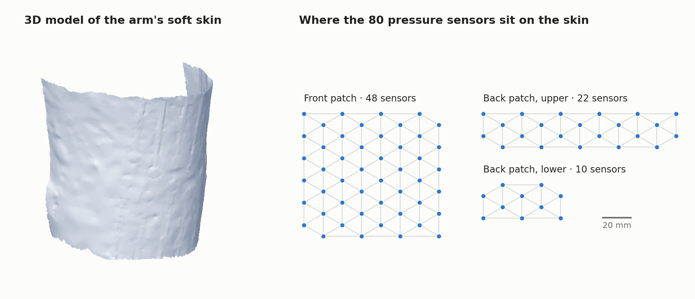

# Teaching a robot where its touch sensors are

A research project I did at Maastricht University in 2023.

**Read the paper:** [Skin Spatial Calibration via Pressure Correlation Measurements (PDF)](MARBLE_Paper.pdf)

*The arm's soft skin (left) and where its 80 pressure sensors sit (right).*

## The problem

A robot arm is covered in soft skin with pressure sensors inside. The robot can feel a touch, but it does not know where on its body each sensor is.

## What I did

I wrote two methods that find the sensor positions from touch alone.

The idea: if two sensors feel pressure at the same moment, they must be close together. Slide an object over the skin many times and you can build a map of all the sensors.

## Result

I tested this in simulation with 100 sensors on a 10 x 10 square.

- A random guess is off by about 4.3 units.
- My first method is off by about 1 unit.
- My second method is off by about 0.6 units.

## Code

The code is in a private repo. It holds the arm's firmware, the scripts that record the sensors, and the recorded data.

## Author

Lukáš Krajčík
